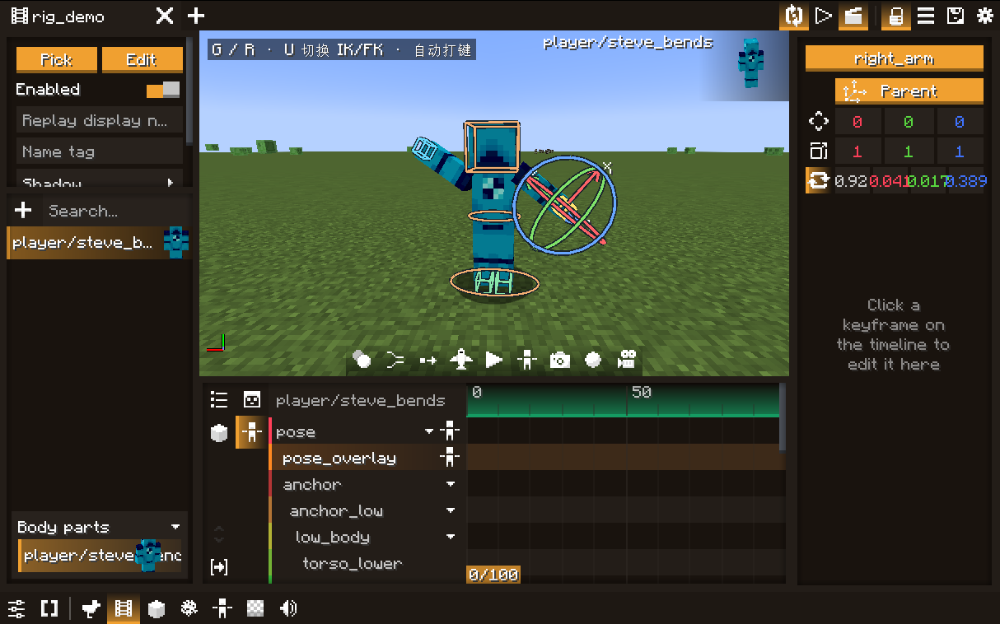
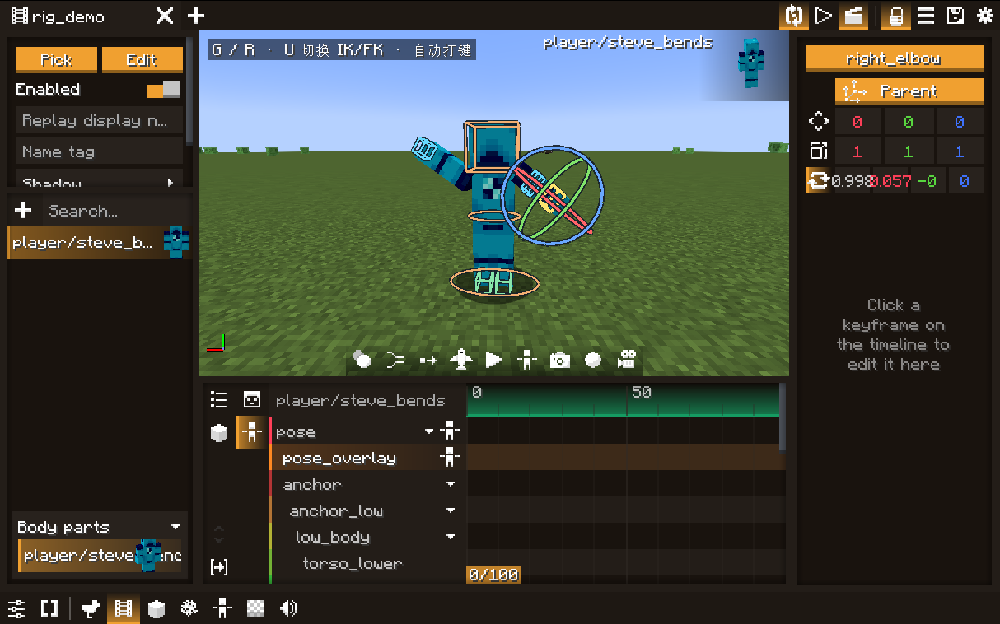
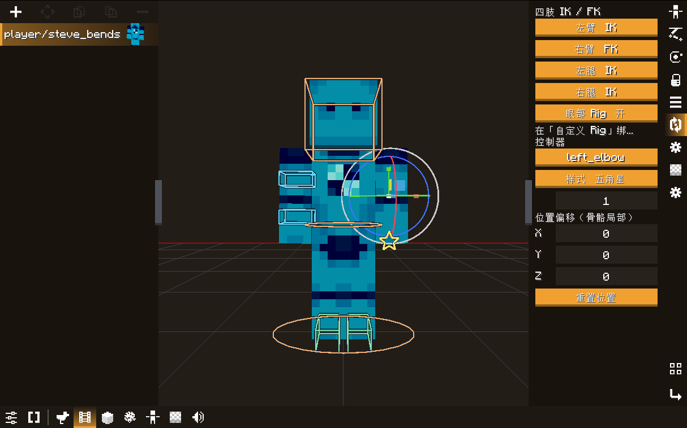

# BBS Rig

为 [BBS FS](https://modrinth.com/mod/bbs-fs) 影片编辑器提供 Blender 式 Rig 控制器的辅助 K 帧插件。直接在人物身上拖控制器摆姿势，松手自动写入 **BBS 原生关键帧**，不用在骨骼列表里一根根找、一个个调数值。

作者：xiaokeDDJ



| 按 U 无缝切换到 FK，姿势不变 | Rig 设置页：控制器样式、缩放、偏移 |
|---|---|
|  |  |

## 环境要求

| 项目 | 版本 |
|---|---|
| Minecraft | 1.20.1 |
| 加载器 | Fabric Loader 0.15 及以上 |
| 前置 | BBS FS 2.7（1.20.1） |
| 运行端 | 仅客户端 |

## 安装

1. 从 [Releases](../../releases) 下载 `bbs-rig-x.y.z.jar`。
2. 放进游戏实例的 `mods` 文件夹。`mods` 里只保留一个版本的 `bbs-rig`，旧版本请先移走。
3. 启动游戏，日志里出现 `bbs_rig` 即表示已加载。

## 快速上手

1. 打开 BBS 影片编辑器，选中一个人物演员。
2. 点击影片编辑器工具栏上的 **Rig 模式** 图标（鼠标悬停时会提示「Rig 模式」），人物身上会出现彩色控制器。
3. 左键点选控制器，然后：
   - 直接拖动 Gizmo 的轴或圆环，或者
   - 按 **G** 移动、**R** 旋转，再移动鼠标，按 **X / Y / Z** 锁定轴向。
4. 松开鼠标或按 **Enter** 时，当前帧会自动写入关键帧；按 **Esc** 撤销这次操作。
5. 换到其他帧重复上面的步骤，拖动时间轴即可预览动画。

空白处左键仍然是转动视角。

## 快捷键

| 按键 | 作用 |
|---|---|
| 左键 | 选中控制器 / 拖动 Gizmo |
| G | 移动选中的控制器 |
| R | 旋转选中的控制器 |
| X / Y / Z | 操作中锁定或解锁对应轴 |
| U | 选中手脚时，在 IK 和 FK 之间切换 |
| S | 双眼控制器沿 XY 缩放瞳孔 |
| K / I | 给选中控制器的当前姿势打关键帧 |
| Enter | 确认并打关键帧 |
| Esc | 取消当前操作 |

右侧面板可以切换坐标系（局部 / 父级 / 全局 / 视图），并实时显示和输入数值。

## 控制器一览

| 控制器 | 说明 |
|---|---|
| 根控制器（地面大圆环） | 整体移动演员，写入演员位置轨道，阴影跟随 |
| 上半身（胯部圆环） | 绕胯部弯腰、转身，双脚保持原位（适用于胯骨同时带动腿和躯干的人模） |
| 腰 / 胸 | 只弯这一段躯干 |
| 头 | 转头 |
| 手、脚 | IK 模式下拖末端，肘和膝自动弯曲；FK 模式下逐节旋转 |
| 眼部 | 双眼视线、左右瞳孔、左右眼睑（需开启眼部 Rig） |

### IK / FK

- **两段式四肢**（带肘、膝，如 `player/*_bends`、`emoticons/*`）：插件自带两段 IK，不依赖模型自带的 IK。
- **单段式四肢**（如 `player/steve`、`player/alex`）：使用瞄准式 IK，拖动手脚末端时，整条胳膊或腿会转向目标。前提是模型里有 `*_end` 末端骨。
- 选中手脚后按 **U** 即可在 IK 和 FK 之间切换。两种模式改的是同一组骨骼旋转，切换时姿势不会跳。
- 模型自带 BBS 原生 IK 时，会显示原生 IK 的目标和极向控制器。

### 眼部 Rig

如果人物带有眼睛骨骼（或独立的眼睛附件模型）：

- 双眼控制器同时带动两个瞳孔，按 S 可缩放；
- 左右瞳孔可以单独移动；
- 左右眼睑往下拖是闭眼，往上拖是睁眼；
- 瞳孔超出眼白的部分会被自动裁掉。

## 设置页面

在 BBS 的形态编辑器中选中模型，会多出两个面板：

**Rig · IK / FK**
- 切换四肢的 IK / FK，开关眼部 Rig。
- 选择任意控制器，设置样式（立方框、圆环、菱形、五角星等 13 种）、显示缩放和位置偏移。左侧预览实时更新。

**自定义 Rig**
- 自动识别不准时，手动指定每个部位对应的骨骼。
- 设置每条肢体的 IK 弯曲方向。
- 绑定眼部骨骼。

这些设置按模型分别保存在 `config/bbs-rig-controls.json`。

## 兼容性

- 支持 BBS 的方块模型（`.bbs.json`）和 BOBJ 模型（`.bobj`）。
- 能自动识别常见的骨骼命名，例如 `left_arm`、`Left_Arm`、`arm.L`、`L_Arm`、`left_elbow`、`right_knee`、`low_left_arm`；IK 控制骨（`controller_*`、`pole_*`）、物品挂点（`*_item`）和末端骨（`*_end`）会自动排除。
- 关键帧全部写入 BBS 原生的骨骼轨道和演员位置轨道。**卸载本插件后，影片仍能正常播放和编辑。**

### 模型作者：rig.json（可选）

在模型文件夹里放一个 `rig.json`，可以固定骨骼绑定和控制器外观：

```json
{
  "bones": { "hand.L": "LeftHand", "hips": "Pelvis" },
  "controls": { "hand.L": { "radius": 8, "color": "#66CCFF" } },
  "swapSides": false
}
```

- `bones`：部位 → 骨骼名。部位名有 `head`、`hips`、`waist`、`upper_arm.L`、`forearm.L`、`hand.L`、`thigh.L`、`shin.L`、`foot.L`，右侧把 `.L` 换成 `.R`。值写空字符串表示不绑定这个部位。
- `controls`：控制器的半径（3～32）和颜色。
- `swapSides`：模型的左右命名和实际方向相反时，设为 `true`。

## 已知限制

- Mixamo 风格的命名（`LeftUpLeg` / `LeftLeg`）会被都识别成大腿，请在「自定义 Rig」里手动绑定。
- 单段四肢的瞄准式 IK 需要 `*_end` 末端骨；没有末端骨的模型会自动使用 FK。

## 反馈

遇到问题请提交 Issue，附上模型 ID、操作步骤和截图。

## 许可

© xiaokeDDJ，保留所有权利。可以免费下载并在自己的作品中使用本插件；未经许可，请勿二次发布或修改后发布。
