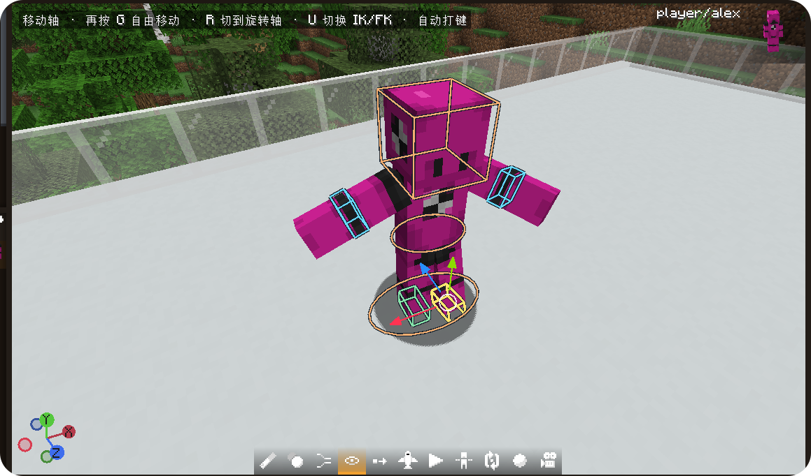
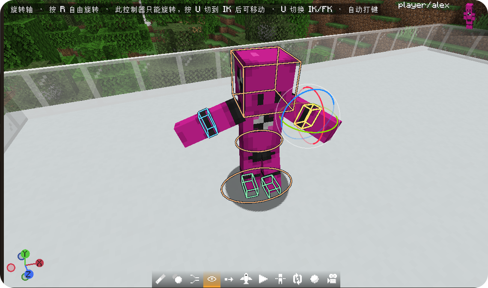
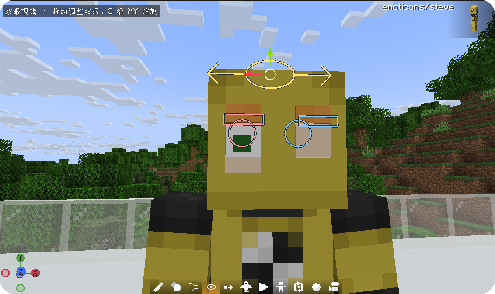
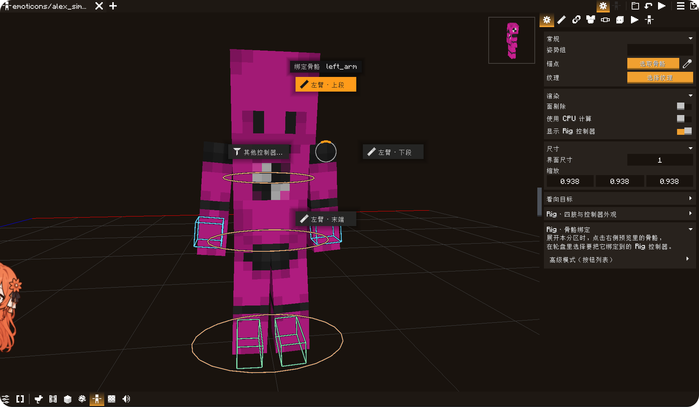
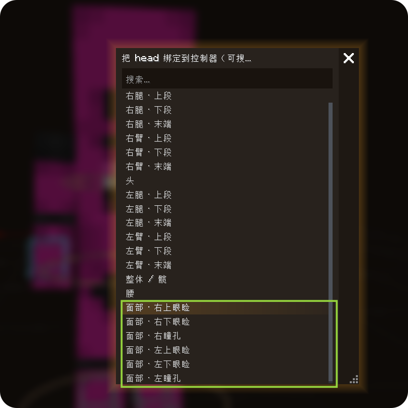
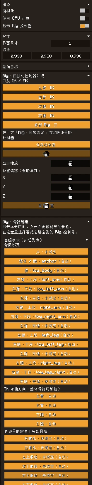

# BBS Rig

**给 BBS FS 影片编辑器加上 Blender 式 Rig 控制器。** 直接在人物身上拖手、脚、腰、头摆姿势，松手就自动写入 BBS 原生关键帧。不用再在骨骼列表里一根根找、一个个调数值。

作者：xiaokeDDJ　·　Minecraft 1.20.1　·　Fabric　·　BBS FS 2.7

| 移动轴：拖箭头或按 G | 旋转轴：拖圆环或按 R |
|---|---|
|  |  |

## ✨ 特色

### 🎯 像 Blender 一样摆姿势
- **G 移动、R 旋转**：第一次按切换 Gizmo，再按一次就跟着鼠标自由移动或旋转，按 X / Y / Z 锁定轴向；拖动中按另一个键可以直接切换操作。
- **Blender 风格 Gizmo**：红绿蓝三轴、实心箭头，旋转环转到背面的半圈会变暗。一次只显示一种，画面清爽。
- 支持局部 / 父级 / 全局 / 视图四种坐标系，右侧面板实时显示数值，也可以直接输入。

### 🦾 IK / FK 一键无缝切换
- **IK**：拖手或脚的末端，肘和膝自然弯曲。
- **FK**：逐节旋转，适合精细调整。
- 选中手脚**按 U 切换**，切换时姿势不会跳，并自动选中对应的控制器。
- **没有自带 IK 的人模也能用 IK**：带肘、膝的人模使用插件自带的两段 IK；手臂和腿只有一节的人模（如 steve、alex）使用瞄准式 IK，拖末端时整条胳膊或腿会转向目标。

### 🧍 为动画准备的身体控制
- **根控制器**平放在脚下的阴影位置：拖动时整体移动演员，阴影跟着走；按 R 可以绕脚下旋转整个人物，倾斜时也不会离开地面。
- **上半身控制器**：绕胯部弯腰、转身，双脚留在原地。
- 头、腰、胸可以单独控制。

### 👀 眼部 Rig
双眼控制器同时带动两个瞳孔；左右瞳孔可以单独移动和缩放；左右眼睑可以单独眨。瞳孔超出眼白的部分会自动裁掉。



### 🎬 写入原生轨道，卸载插件也能播放
松手或按 Enter 时自动在当前帧打关键帧，Esc 撤销。骨骼动画写进 BBS 原生的骨骼轨道，整体移动写进演员位置轨道。**影片不依赖本插件，卸载后照样能播放和编辑。**

### 🛞 轮盘式骨骼绑定
在 BBS 模型编辑器里点一下骨骼，会弹出 Blender 风格的饼菜单，选择要把它绑定到哪个 Rig 控制器。也可以搜索全部控制器，或一键恢复自动识别。

| 点骨骼弹出轮盘 | 「其他控制器…」可搜索全部控制器 |
|---|---|
|  |  |

### 🧩 兼容各种人模
- 支持方块模型（`.bbs.json`）和 BOBJ 模型（`.bobj`）。BBS 内置的 `player/*`、`*_bends`、`emoticons/*` 都能直接使用。
- 能自动识别常见的骨骼命名：`left_arm`、`Left_Arm`、`arm.L`、`L_Arm`、`left_elbow`、`right_knee`、`low_left_arm` 等，并自动排除 IK 控制骨、物品挂点和末端骨。
- 识别不准时，可以用轮盘或「高级模式」手动绑定。

## 环境要求

| 项目 | 版本 |
|---|---|
| Minecraft | 1.20.1 |
| 加载器 | Fabric Loader 0.15 及以上 |
| 前置 | BBS FS 2.7（1.20.1） |
| 运行端 | 仅客户端 |

## 安装

1. 从 [Releases](../../releases) 下载最新的 `bbs-rig-x.y.z.jar`。
2. 放进游戏实例的 `mods` 文件夹。`mods` 里只保留一个版本的 `bbs-rig`。
3. 启动游戏。

## 快速上手

1. 打开 BBS 影片编辑器，选中一个人物演员。
2. 点击工具栏上的 **Rig 模式** 图标（鼠标悬停时会提示「Rig 模式」），人物身上会出现彩色控制器。
3. 左键点选控制器，然后拖动箭头或圆环，或者用 G / R 自由操作。
4. 松开鼠标或按 Enter 会自动打关键帧，Esc 撤销。
5. 换到其他帧继续摆姿势，拖动时间轴就能预览动画。

空白处左键仍然是转动视角。

## 快捷键

| 按键 | 作用 |
|---|---|
| 左键 | 选中控制器 / 拖动 Gizmo |
| G | 切到移动箭头；再按一次自由移动 |
| R | 切到旋转环；再按一次自由旋转 |
| X / Y / Z | 操作中锁定或解锁对应轴 |
| U | 选中手脚时，在 IK 和 FK 之间切换 |
| S | 双眼控制器沿 XY 缩放瞳孔 |
| K / I | 给选中控制器的当前姿势打关键帧 |
| Enter / 左键 | 确认并打关键帧 |
| Esc / 右键 | 取消当前操作 |

FK 段、头、腰这类控制器只能旋转，按 R 直接开始旋转。

## 设置

打开 BBS 的**模型编辑器**（底部工具栏），选中人模，在「常规」标签页里：

- **渲染 → 显示 Rig 控制器**：控制模型编辑器预览里是否显示控制器。
- **Rig · 四肢与控制器外观**：
  - 切换四肢 IK / FK，开关眼部 Rig；
  - 选择控制器，设置样式（立方框、圆环、菱形、五角星等 13 种）、显示缩放和位置偏移。也可以直接在预览里点控制器来选中，预览实时更新。
- **Rig · 骨骼绑定**：展开后，点击预览里的骨骼，在轮盘中选择控制器。下方的「高级模式」里有完整的按钮列表，还可以设置每条肢体的 IK 弯曲方向。

设置按模型分别保存在 `config/bbs-rig-controls.json`。

<details>
<summary>查看完整设置页截图</summary>



</details>

### 模型作者：rig.json（可选）

在模型文件夹里放一个 `rig.json`，可以预设骨骼绑定和控制器外观：

```json
{
  "bones": { "hand.L": "LeftHand", "hips": "Pelvis" },
  "controls": { "hand.L": { "radius": 8, "color": "#66CCFF" } },
  "swapSides": false
}
```

- `bones`：部位 → 骨骼名。可用的部位有 `head`、`hips`、`waist`、`upper_arm.L`、`forearm.L`、`hand.L`、`thigh.L`、`shin.L`、`foot.L`，右侧把 `.L` 换成 `.R`。值写空字符串表示不绑定该部位。
- `controls`：控制器半径（3～32）和颜色。
- `swapSides`：模型的左右命名与实际方向相反时设为 `true`。

## 已知限制

- Mixamo 风格的命名（`LeftUpLeg` / `LeftLeg`）会被都识别成大腿，请用轮盘手动绑定。
- 单段四肢的瞄准式 IK 需要模型带有 `*_end` 末端骨；没有末端骨的模型会自动使用 FK。

## 反馈

遇到问题请提交 Issue，附上模型 ID、操作步骤和截图。

## 许可

© xiaokeDDJ，保留所有权利。可以免费下载并在自己的作品中使用本插件；未经许可，请勿二次发布或修改后发布。
